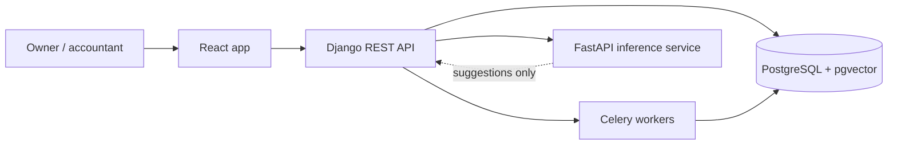

# LedgerLens

**Cash-flow simulator for independent businesses.** LedgerLens lets freelancers and small agencies rehearse future decisions, like "what if a client pays 18 days late and I buy a laptop next Thursday?", and see the effect on their cash runway before it happens.

> **Status:** early development, following an 8-week roadmap (see below). The project uses synthetic business records and uploaded CSV files only. It does not connect to real bank accounts.

## The problem

A freelancer or small agency can have profitable invoices on paper and still run out of cash before payroll or rent. Typical budgeting apps chart past transactions; they don't help you test a decision before you make it.

LedgerLens keeps deterministic accounting calculations separate from AI explanations: the numbers always come from the ledger and the forecast engine, and AI only explains them.

## Who it's for

- **Owners:** run the business, explore scenarios and approve changes
- **Accountants:** review and correct the ledger
- **Analysts:** read forecasts without changing anything

## Demo workflow

1. Upload a sample bank CSV
2. Review unmatched lines
3. Approve suggested categories
4. Create an invoice
5. Move its expected payment date 18 days later
6. Watch the forecast update
7. Ask "Which bills create the shortfall?" and get a short answer that links to the real invoices and forecast version

## Planned features

- Workspaces with owner, accountant and analyst roles
- Bank statement CSV import with column mapping, reconciliation and traceable source hashes
- Ledger with accounts, transactions, rule-based categories and split transactions
- Invoices and bills with due dates and explicit state transitions
- Dashboard with actual cash, upcoming bills, receivables and runway
- Scenario studio with sliders for payment delays, spending and recurring revenue
- AI category suggestions with a confidence score and reason, which a person approves or rejects
- Cash-flow briefing: plain-language answers grounded in the computed forecast, with citations
- Member management, activity history and CSV export

## Tech stack

| Layer | Technology |
|---|---|
| Frontend | React, TypeScript |
| Business API | Django, Django REST Framework |
| AI inference API | FastAPI |
| Database | PostgreSQL with pgvector |
| Background jobs | Redis, Celery |
| Local environment | Docker Compose |
| CI | GitHub Actions |

## Architecture

The Django API is the authoritative source for all business data. A separate FastAPI service handles AI inference and never writes to the ledger directly. Imports and forecasts run as Celery background jobs.



## Design rules

- Money is stored as integer minor units or exact decimals, never floating point.
- Re-importing the same file never creates duplicate transactions.
- Confirmed imports can't silently change the original transaction.
- Scenarios are independent versions; the real ledger never changes.
- Every AI-proposed change needs a person's approval.
- Every amount in an AI answer comes from server-computed numbers.
- Organization ownership is enforced on every endpoint.

## Roadmap

| Week | Focus | Status |
|---|---|---|
| Week 1 | **Product definition & dev environment** — Add product charter, personas, backlog and React app shell, bootstrap Django REST and FastAPI health services with Compose | ✅ Done |
| Week 2 | **Identity, tenancy & authorization** — Add organizations, memberships and session endpoints, add React sign-in, workspace switcher and tenant-scoped permissions | Planned |
| Week 3 | **Ledger & accounting primitives** — Add accounts, categories, transactions and balanced journal posting, add paginated ledger endpoints and React transactions table | Planned |
| Week 4 | **CSV import, reconciliation, bills & invoices** — Add CSV import batches with column mapping and replay protection, add invoices, bills, customers and vendors with state transitions, add invoice and bill views with status actions | Planned |
| Week 5 | **Forecast engine & scenarios** — Add deterministic daily cash projection, add scenario overlays for payment delays and one-off costs | Planned |
| Week 6 | **AI categorization, background jobs & staging** — Add categorization schema, provider interface and mock client, add idempotent Celery jobs for imports, categorization and forecasts, provision staging with managed PostgreSQL | Planned |
| Week 7 | **Cited cash-flow briefings, reports & reliability** — Add facts envelope and structured briefing schemas, add monthly net cash and category trend APIs, add traces, metrics and SLO dashboard | Planned |
| Week 8 | **Security hardening & release** — Review authorization on every endpoint and internal token audiences, run abuse tests for CSV uploads and prompt injection, freeze v1 scope and tag release candidate, deploy v1 demo with HTTPS and monitoring | Planned |

## Documentation

- [Product charter](docs/product/charter.md), [personas](docs/product/personas.md) and [backlog](docs/product/backlog.md)
- [ADR 0001: modular monorepo and service boundaries](docs/adr/0001-modular-monorepo-and-service-boundaries.md)
- [Getting started](docs/setup/getting-started.md)
- [Weekly progress](docs/progress/)

## Getting started

Requires Docker with the Compose plugin, Node.js 22 and pnpm 10.

```bash
scripts/dev.sh up    # creates .env, builds and starts PostgreSQL, Redis, core-api and ai-api
scripts/dev.sh web   # React dev server on http://localhost:5173
scripts/dev.sh check # lint and unit tests (same as CI)
```

See [docs/setup/getting-started.md](docs/setup/getting-started.md) for ports, environment
variables and troubleshooting.
